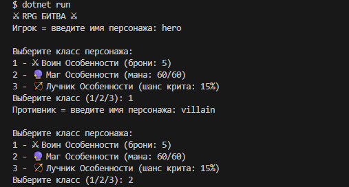
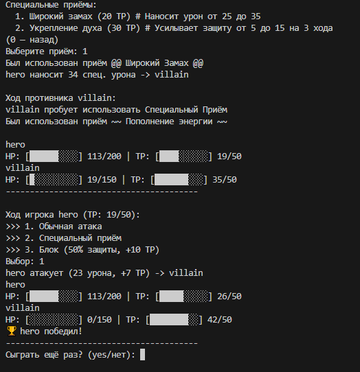

# Учебное проект. РПГ-Битва 

Проект, основанный на лабораторной, который является дополненной версией

## Скриншоты
---

## Как играть
---
- Запустите приложение
- Назовите персонажа и дайте ему класс
- Сделайте тоже самое, но с противником
- Используйте атаку, специальные приёмы и блок, чтобы победить противника!
- Чтобы продолжить, напишите **yes** 

## Запуск проекта
---
~~~
git clone https://github.com/Westigrannik/RPG_Project

cd RPG_2.0

dotnet run
~~~
## Технологии
---
Язык программирования C#

## Что изучено
---
- Работа с классами
- Работа с разными состояниями объектов
- Работа с переписыванием классов

## Автор
---
**Вовк Тимофей** - Группа ИСП-242
16.11.2026